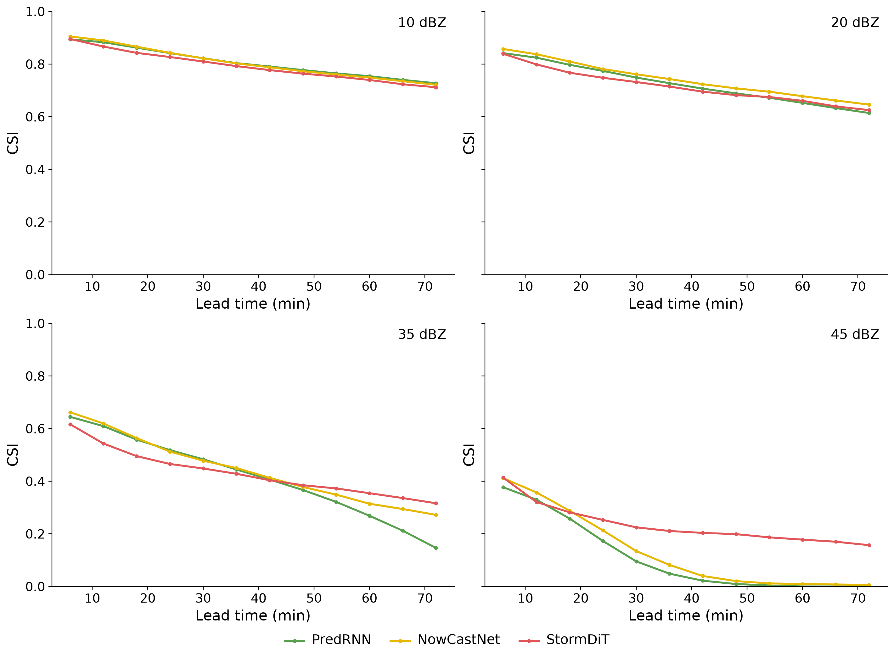
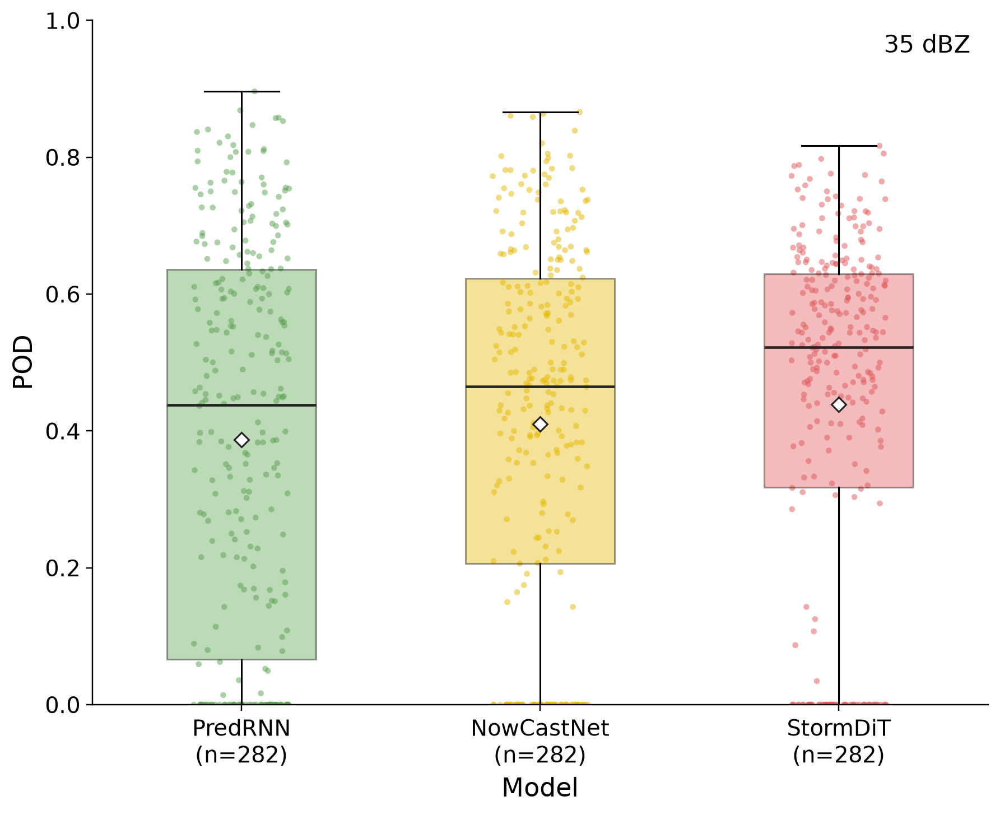
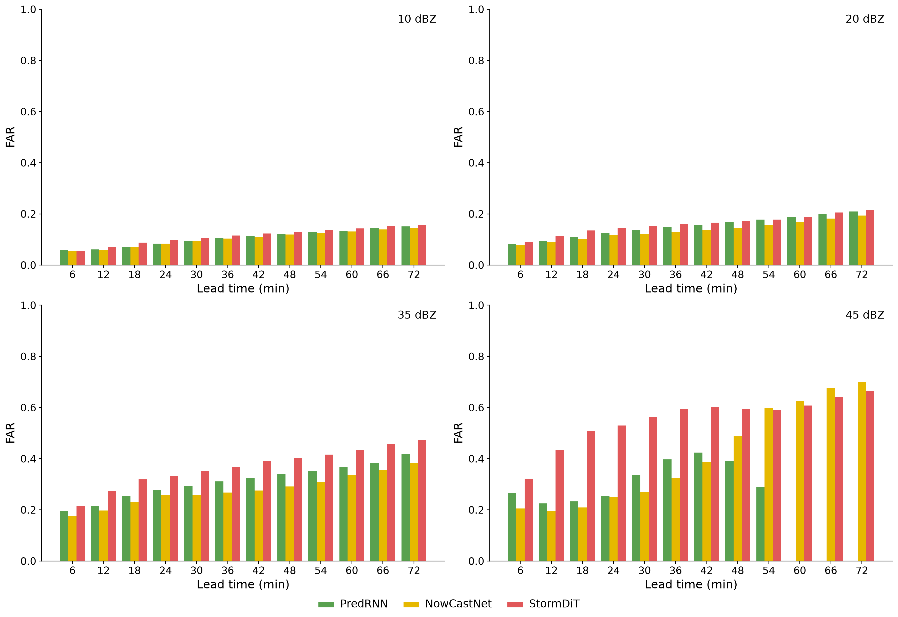
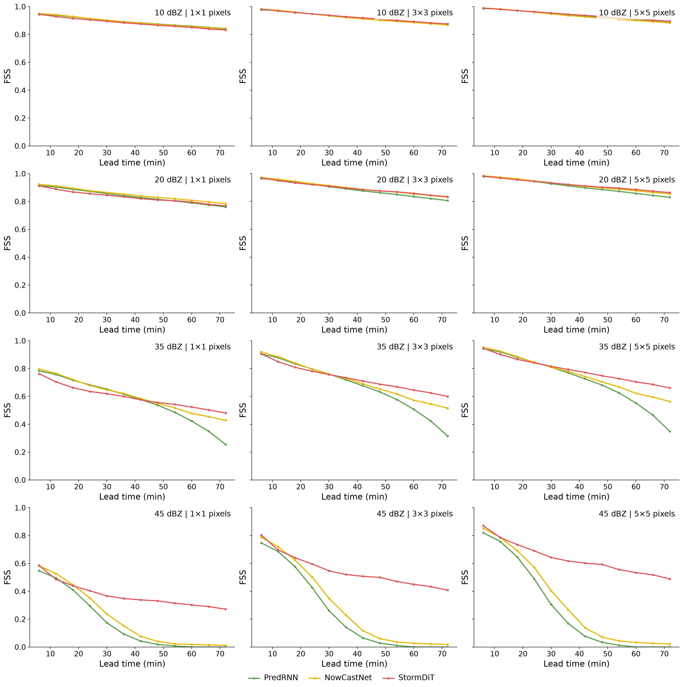

# 老师修改版样图

以下四张图来自真实资料计算，供直接预览。资料为 2025-04-11 Wuhan Benchmark，
使用 PredRNN、NowCastNet、StormDiT 的 24 个公共起报，预报时效 6–72 分钟。
配色：PredRNN 绿色、NowCastNet 黄色、StormDiT 红色。
模型统一按此顺序排列。所有图取消上方标题，阈值和尺度在图内标注，便于论文排版。

## CSI 时效曲线

10、20、35、45 dBZ 四阈值。

## POD 箱线图

选取 35 dBZ 作为示例；每个模型的样本为公共起报×时效的有效 POD。
箱体表示四分位距，横线为中位数，菱形为均值；未定义的评分不作为零参与统计。

## FAR 分组柱状图

横轴为时效，按模型分组、按阈值分面。使用汇总列联表计算 FAR。

## FSS 多尺度曲线

10、20、35、45 dBZ × 1、3、5 像元邻域。所有图支持同步添加55 dBZ等阈值。

通过网页“检验功能与提示词”中的“老师修改版四类图”模板可重新生成。
完整修改说明见 [TEACHER_FIGURES.md](../../TEACHER_FIGURES.md)。
